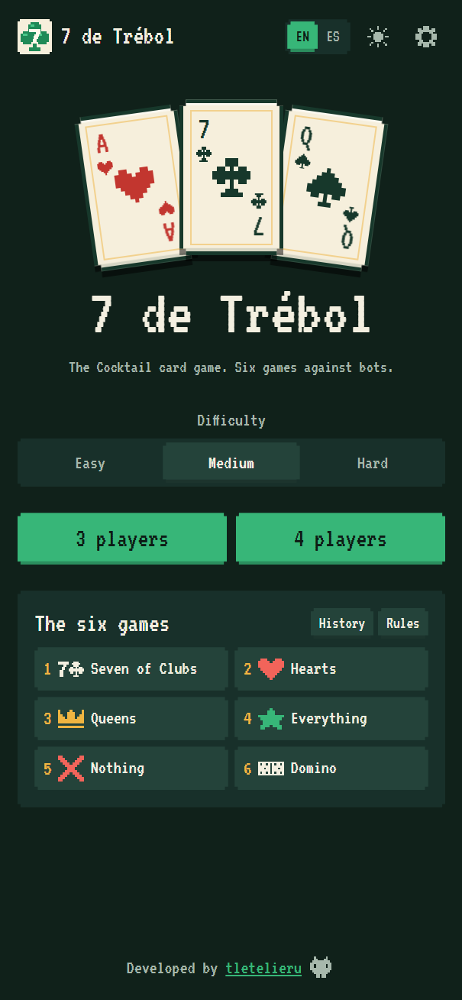
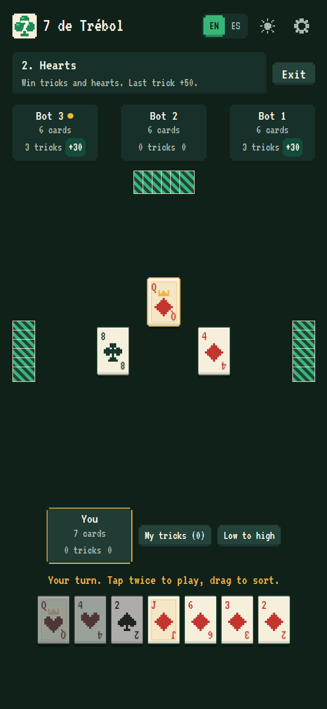
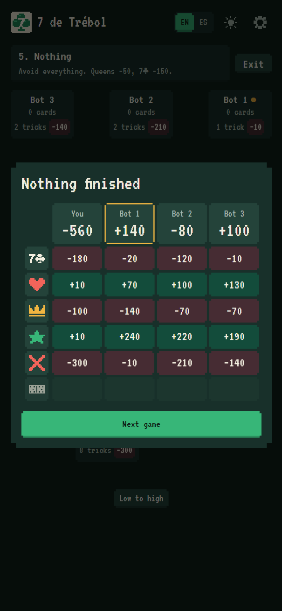
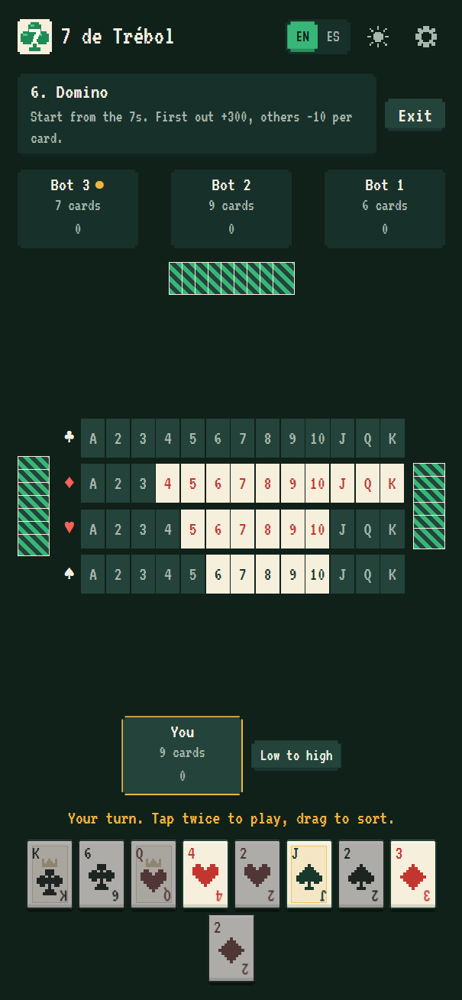
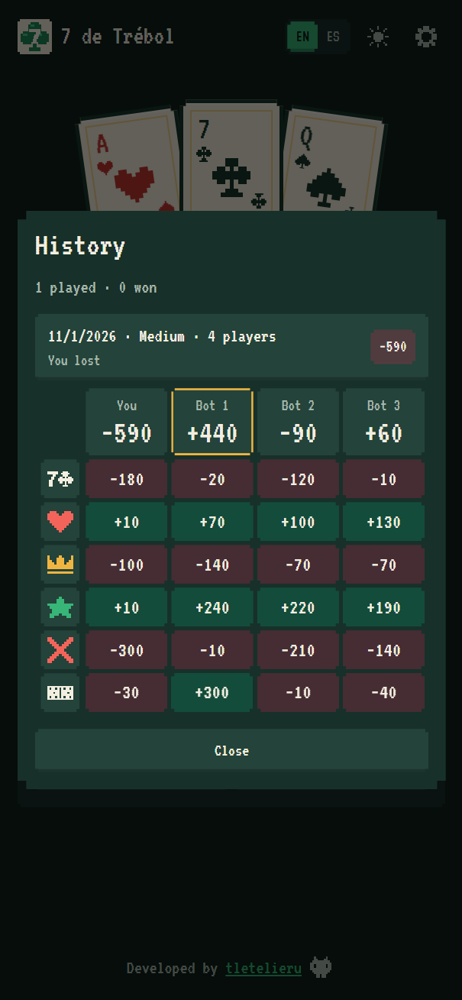

# ♣ 7 de Trébol

Play Cocktail, the family card game, on your phone or computer. Six games in a row, against bots that
actually think: five trick-taking games and a final round of domino.

No account and no backend. Everything runs on your device, and your match is saved after every move.

<p align="center">
  
  
  
</p>

## The six games

Every match plays all six, always in this order. Highest total wins.

| # | Game | Goal | Scoring |
| --- | --- | --- | --- |
| 1 | Seven of Clubs | Avoid tricks | Each trick −10, 7♣ −150, last trick −50 |
| 2 | Hearts | Win tricks and hearts | Each trick +10, each heart +10, last trick +50 |
| 3 | Queens | Avoid tricks and queens | Each trick −10, each queen −50, last trick −50 |
| 4 | Everything | Win it all | Tricks and hearts +10, queens +50, 7♣ +150, last trick +50 |
| 5 | Nothing | Avoid it all | Tricks and hearts −10, queens −50, 7♣ −150, last trick −50 |
| 6 | Domino | Empty your hand first | First out +300, everyone else −10 per card |

You must follow suit, there are no trumps, and the last trick counts double: its normal 10 plus 50.
With 3 players the 2 of diamonds is removed. The full rules are inside the game.

<p align="center">
  
  
</p>

## What you get

- **Three difficulties:** Easy makes mistakes, Medium plays sound heuristics and Hard simulates the
  rest of each game before it moves
- **3 or 4 players:** you against 2 or 3 bots
- **Your hand, your way:** drag cards to sort them, or flip between high to low and low to high
- **Match history:** finished and abandoned matches, with the score of every game
- **Saved matches:** reload, close the tab or turn off your phone, and the match comes back
- **Live score:** check every game so far, including the one in progress
- **My tricks:** check the tricks you have taken in the current game
- **Chiptune music:** written in code, with a switch to mute it

### Accessibility and comfort

Settings has larger text sizes, a regular font instead of the pixel one, four-color suits, highlighted
key cards and a switch to turn off animations. It also comes in English and Spanish, with light and
dark mode. Install it as an app and it works offline.

## How strong are the bots?

Each row is one bot against a table of the other, with the seat rotating every match.

| Bot | Against | Players | Matches | Wins | Even odds |
| --- | --- | --- | --- | --- | --- |
| Hard | Medium | 4 | 300 | 58.0% ±5.6 | 25% |
| Hard | Medium | 3 | 120 | 72.5% ±8.0 | 33.3% |
| Medium | Easy | 4 | 10,000 | 38.6% ±1.0 | 25% |
| Medium | Easy | 3 | 10,000 | 53.7% ±1.0 | 33.3% |

## Run it locally

Requires Node 24 and pnpm 9.

```sh
pnpm install
pnpm dev
```

| Command | What it does |
| --- | --- |
| `pnpm test` | Runs the unit and property tests |
| `pnpm lint` | Runs ESLint |
| `pnpm typecheck` | Runs the type checks |
| `pnpm build` | Builds the app |
| `pnpm sim --hero hard --field medium --matches 100` | Plays bots against each other |

## How it works

| Folder | What lives there |
| --- | --- |
| `packages/engine` | Rules, legal moves and scoring, with no UI code |
| `packages/bots` | Easy, Medium and Hard |
| `apps/client` | The game, built with React, Tailwind and Vite |
| `apps/sim` | Command line tool for bot matches |

The engine is pure and serializable, so saved matches, the bots and a future online server all share
it. Bots only receive what their seat can see, so they can't peek at your hand. Thousands of random
matches check that cards are never lost and that every game adds up to its fixed total.

The Hard bot tracks which rival can hold each card, deals out possible hands, plays each option to the
end of the game and picks the one that does best against the leader. It runs in a Web Worker, so the
table never freezes.

All cards, icons and music are original. See [the development plan](docs/PLAN.md) for what comes next.

## License

Copyright (c) 2026 tletelieru. All rights reserved. See [LICENSE](LICENSE).

---

Developed by [tletelieru](https://tletelieru.github.io/tletelieru/) · [GitHub](https://github.com/tletelieru)
